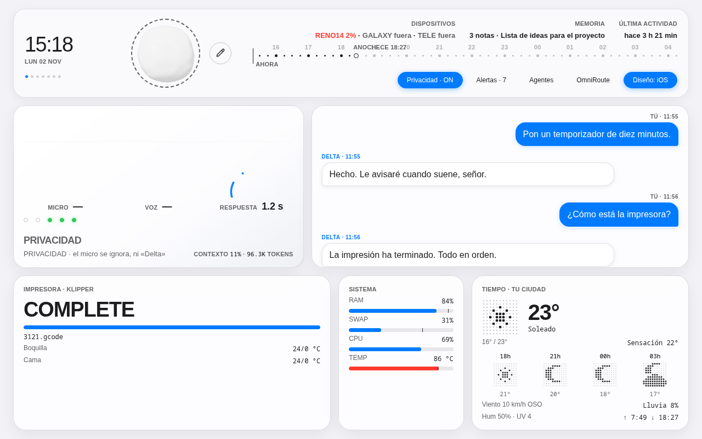

# DeltaOS

[English](README.md) · **Español**


_Panel DeltaOS (captura con datos de ejemplo)._

Asistente de voz personal para el escritorio, con un panel web propio. Se llama **Delta**, se activa con la palabra «Delta» y habla con la sesión en tiempo real de **Gemini Live** (`gemini-3.8-live`). Delegar es su fuerte: cuando la tarea es de código, de búsqueda o de documentos, la pasa al agente adecuado y cuenta el resultado.

> Proyecto personal en uso diario sobre Fedora (KDE/Wayland). Está pensado para mi máquina; el código es público para enseñar cómo está montado, no como producto listo para instalar.

## Qué hace

- **Voz de baja latencia:** micrófono, palabra de activación (`livekit-wakeword`), conversación bidireccional con Gemini Live y herramientas que el modelo invoca por función.
- **Panel DeltaOS** (`panel/`, aiohttp + WebSocket en `127.0.0.1:7876`): estado en vivo, mascota 3D, fondos con shaders, notas, avisos y un modo teclado.
- **Multi-agente:** delega en Claude Code (por ACP), en servidores MCP y en un puente con Antigravity; hay un catálogo de agentes (`agentes_catalogo.py`).
- **Memoria** en SQLite con FTS5 (`memoria.py`), hábitos, avisos proactivos y notificaciones push web al móvil (`pywebpush`).
- **Visión** (`vision.py`, mediapipe + OpenCV): saber si el usuario está delante, gestos y pantallas.
- **Entorno de casa:** Telegram, control de una Fire TV por ADB (`firetv.py`) y una pasarela ligera (`pasarela/`) que corre en una placa Armbian y se alcanza por Tailscale.
- **Documentos:** crear, convertir y estudiar PDF (`secretario.py`, `estudio*.py`).

## Seguridad por diseño

- Las órdenes del panel entran solo por WebSocket, que comprueba `Origin`; no hay endpoints HTTP que hagan hablar a Delta.
- Enviar mensajes, apagar el equipo, instalar skills o lanzar comandos que cambian algo exige confirmación del usuario, de viva voz.
- La impresora 3D que monitoriza es de **solo lectura** (únicamente GET).
- Secretos en `.env`, claves y bases de datos fuera del control de versiones (`.gitignore`).

## Estructura

| Ruta | Para qué sirve |
|---|---|
| `assistant.py` | Bucle principal: micro, palabra de activación, sesión Gemini Live |
| `acciones.py` | Herramientas que Gemini puede llamar y estado compartido |
| `deltaos.py` | Visor del panel, búsqueda, informes y skills |
| `claude_acp.py` | Claude Code por ACP (`hablar_con_claude`, `mejorar_delta`) |
| `panel.py`, `panel/` | Servidor y frontend del panel |
| `memoria.py` | Memoria persistente SQLite + FTS5 |
| `vision*.py` | Visión por cámara |
| `firetv.py`, `firetv/` | Fire TV por ADB y app Android del micro del mando |
| `pasarela/` | Página «PC apagado» y acceso móvil, en la placa Armbian |
| `skills/` | Skills de agente que usa el desarrollo del proyecto |
| `PLAN_V3.md`, `CAMBIOS_DELTA.md` | Plan de diseño y registro de cambios |
| `test_*.py` | Pruebas, un fichero por módulo |

## Requisitos

- Linux con PipeWire, `wl-clipboard`, `kdotool`, `ffmpeg`, `adb` y `python3-gobject`.
- Python 3.14 (el del entorno de desarrollo) y una clave de la API de Gemini.
- Opcional: Claude Code (`claude`) para la delegación de código, un bot de Telegram, una Fire TV.

## Puesta en marcha

```bash
python3 -m venv .venv
.venv/bin/pip install -r requirements.txt
echo "GEMINI_API_KEY=tu_clave" > .env
./run.sh
```

Después, el panel está en <http://127.0.0.1:7876>.

## Pruebas

Cada módulo trae su prueba, que se ejecuta suelta:

```bash
.venv/bin/python test_memoria.py
```

## Licencia

[MIT](LICENSE).
