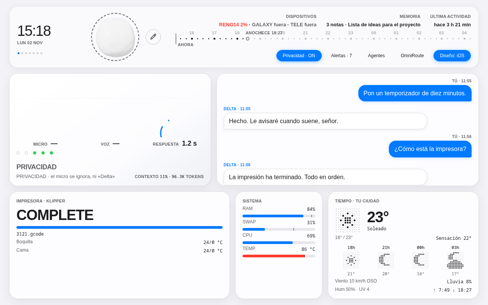

# DeltaOS

**English** · [Español](README.es.md)


_DeltaOS panel (screenshot with sample data)._

A personal desktop voice assistant with its own web dashboard. It is called **Delta**, wakes on the word "Delta" and talks over a real-time **Gemini Live** session (`gemini-3.8-live`). Its strength is delegation: when a task is about code, search or documents, it hands it to the right agent and reports back.

> A personal project in daily use on Fedora (KDE/Wayland). It is built around my own machine; the code is public to show how it is put together, not as a ready-to-install product.

## Features

- **Low-latency voice:** microphone, wake word (`livekit-wakeword`), bidirectional conversation with Gemini Live, and tools the model calls as functions.
- **DeltaOS dashboard** (`panel/`, aiohttp + WebSocket on `127.0.0.1:7876`): live status, 3D mascot, shader backgrounds, notes, alerts and a keyboard mode.
- **Multi-agent:** delegates to Claude Code (over ACP), to MCP servers and to an Antigravity bridge, with an agent catalogue (`agentes_catalogo.py`).
- **Memory** in SQLite with FTS5 (`memoria.py`), habits, proactive alerts and web push notifications to the phone (`pywebpush`).
- **Vision** (`vision.py`, mediapipe + OpenCV): presence, gestures and screens.
- **Home integration:** Telegram, Fire TV control over ADB (`firetv.py`) and a light gateway (`pasarela/`) running on an Armbian board, reachable over Tailscale.
- **Documents:** create, convert and study PDFs (`secretario.py`, `estudio*.py`).

## Safety by design

- Dashboard commands only come in through a WebSocket that checks `Origin`; there are no HTTP endpoints that make Delta speak.
- Sending messages, powering off the machine, installing skills or running state-changing commands requires the user's spoken confirmation.
- The 3D printer it monitors is **read-only** (GET requests only).
- Secrets live in `.env`; keys and databases are kept out of version control (`.gitignore`).

## Layout

| Path | Purpose |
|---|---|
| `assistant.py` | Main loop: mic, wake word, Gemini Live session |
| `acciones.py` | Tools Gemini can call, and shared state |
| `deltaos.py` | Dashboard viewer, search, reports and skills |
| `claude_acp.py` | Claude Code over ACP (`hablar_con_claude`, `mejorar_delta`) |
| `panel.py`, `panel/` | Dashboard server and frontend |
| `memoria.py` | Persistent memory, SQLite + FTS5 |
| `vision*.py` | Camera vision |
| `firetv.py`, `firetv/` | Fire TV over ADB and the Android remote-mic app |
| `pasarela/` | "PC is off" page and mobile access, on the Armbian board |
| `skills/` | Agent skills used while developing the project |
| `PLAN_V3.md`, `CAMBIOS_DELTA.md` | Design plan and change log (in Spanish) |
| `test_*.py` | Tests, one file per module |

## Requirements

- Linux with PipeWire, `wl-clipboard`, `kdotool`, `ffmpeg`, `adb` and `python3-gobject`.
- Python 3.14 (the development environment) and a Gemini API key.
- Optional: Claude Code (`claude`) for code delegation, a Telegram bot, a Fire TV.

## Getting started

```bash
python3 -m venv .venv
.venv/bin/pip install -r requirements.txt
echo "GEMINI_API_KEY=your_key" > .env
./run.sh
```

The dashboard is then at <http://127.0.0.1:7876>.

## Tests

Each module ships its own test, run standalone:

```bash
.venv/bin/python test_memoria.py
```

## License

[MIT](LICENSE).
